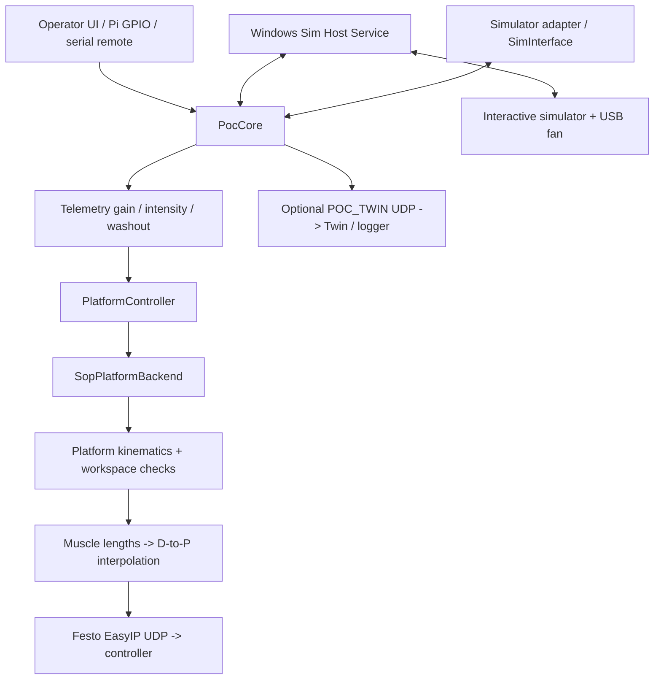

<!-- ARCHITECTURE.md ver 4 -->
# Platform Operators Console — Architecture and Hardware Guide

**Audience:**  maintainers, Engineering students and researchers extending the motion-platform system  
**Companion:** [Project Ideas](Project%20Ideas.md) · [Repository README](../README.md) · [Raspberry Pi technician guide](raspberry_pi/POC_Raspberry_Pi_Technician_Guide.md)

## 1. Purpose and boundaries

Platform Operators Console (**POC**) provides operator control of the Middlesex University suspended six-degree-of-freedom (6-DOF) pneumatic motion platform. 

The software typically runs as a PyQt5 desktop application on a Raspberry Pi, although it can be run on Windows. It communicates with the motion sim, for example the NoLimits roller coaster that is running on a Windows PC.  The PC software: **Sim Host Service (SHS)** starts/controls interactive simulators, relays information and controls a separate fan interface. POC converts simulator cues into six pneumatic-muscle commands using platform-specific kinematics and empirical length-to-pressure calibration. An optional one-way **Digital Twin** UDP stream publishes calculated/commanded state to external visualizers and recorders.

When driving the physical platform, the application must be used with safety-rated hardware emergency-stop and other independent protective systems.

## 2. Physical system

### Suspended Stewart platform

The platform is an **inverted Stewart mechanism**: a fixed overhead support structure has six upper attachment points; six pneumatic 'muscles' connect these to six points on a moving lower platform. The muscles are fibre-reinforced flexible tubes which contract as their internal air pressure increases. They provide a mechanically simple means of producing a combined pulling force equivalent to approximately half a metric ton, without motors, gearboxes or hydraulic systems normally associated with a motion platform. 
The muscles are arranged such that contracting combinations of actuators creates translation and rotation with six degrees of freedom. These are conventionally referred to as `x (surge), y (sway), z (heave), roll, pitch, yaw`.

### Configured physical variants

| POC selector | Configuration | Muscle nominal maximum | Key differences |
| --- | --- | ---: | --- |
| `platform_v2` | `kinematics/cfg_SuspendedPlatformMdx.py` | 1,000 mm | MDX suspended/wheelchair-oriented platform; CAD-derived XYZ joint geometry; no prop piston; floor/actuator workspace limiter enabled |
| `chair_v3` | `kinematics/cfg_SuspendedChair.py` | 800 mm | Suspended chair geometry; commanded prop piston sequence; workspace limiter currently off |
| `chair_v2` | Same `cfg_SuspendedChair.py` | 800 mm | Legacy selection retained for configuration compatibility; not a separate current geometry model |
| `Falcon` | `kinematics/cfg_SuspendedChairFalcon.py` | 1,000 mm | Separate Falcon geometry; no prop piston in configuration |

Configuration is chosen using `config/platforms.py`; changes to the selected physical platform are persisted and applied **after POC restarts**, not while active. Do not assume that the configured platform is the one physically connected without commissioning checks.

For platform_v2, the model specifies 1,000 mm maximum and 750 mm minimum muscle length plus 200 mm nominal fixed attachment hardware per actuator, giving 1,200..950 mm total attachment-to-attachment lengths. Its CAD-derived geometry is in millimetres, with **84 mm subtracted from CAD Z** to define the POC reference. The configured underside and floor are at local Z = -80 and -84 mm respectively. The software uses an approximate moving-platform underside hull to enforce a nominal 15 mm active floor-clearance requirement. Those are **software geometry assumptions**, not independent collision sensors.

The `platform_v2` design targets wheelchair accessibility: the moving structure rests at floor level when parked, permitting level boarding without a ramp or lift. Actual boarding clearances and safeguarding must be verified on the physical installation.

The suspended-chair config has a separate 800 mm muscle model and prop/piston sequencing (`HAS_PISTON=True`). The Falcon and MDX configs use 1,000 mm muscles. Configured payload classes and pressure tables differ among platforms; do not transfer calibration or actuator limits without validation.

The Falcon platform was developed for the Royal Aeronautical Society.

### Pneumatic/electrical chain and safety

```text
Six upper clevis/attachment points on the fixed structure
             |  six pneumatic muscles + fixed end hardware
             v
Six lower attachments on moving deck / chair

POC -> six calculated pressure commands -> Festo EasyIP UDP -> valve/controller
                                           -> pressure/airflow -> muscle contraction
```

The current `output/festo_itf.py` defaults to **transmit-only** Festo commands (`wait=False`, `poll_pressures=False`). Some chair commands carry a seventh word for the **commanded** prop state. Neither a successful UDP send nor an updated POC value proves that a muscle, valve, platform, or prop moved.

The existing independent hardware E-stop removes valve/prop power. That is distinct from POC's **software-controlled abort and parking sequence**. Removing power may prevent software parking; the actual stopped position and mechanical support must be evaluated independently.

## 3. System architecture and signal paths



This diagram shows software responsibilities, not a certified interlock or real-time hardware-feedback loop. The 50 ms core data timer aims for **20 Hz**; application scheduling, network delivery and actual platform response may differ.

### Principal code ownership

| File or directory | Responsibility | Where to make changes |
| --- | --- | --- |
| [`poc.py`](../poc.py), [`ui/main_window.py`](../ui/main_window.py), `.ui` files | Application entry; Qt windows, buttons, compact and full-size layouts | Operator presentation; never bypass core checks from a UI callback |
| [`core/poc_core.py`](../core/poc_core.py) | Core 50 ms loop, operator actions, state coordination, dispatch, telemetry processing, fan, Twin snapshot | Common behaviour and simulator/platform coordination |
| [`core/types.py`](../core/types.py) | State enums and shared `SimSample`, `SimStatus` contract | Common meanings and invariants |
| [`core/platform_controller.py`](../core/platform_controller.py) | Physical/logical activation, parking/unparking, prop timing, workspace limits and backend | Safe state transitions and commanded motion |
| [`core/sim_interface.py`](../core/sim_interface.py), [`core/sim_registry.py`](../core/sim_registry.py), [`sims/`](../sims/) | Common simulator API and NoLimits2/SpaceCoaster/X-Plane adapters | Simulator-specific integration; keep physical output out |
| [`core/telemetry_config.py`](../core/telemetry_config.py) | Per-simulator gain, intensity-related processing and washout filter settings | Cue shaping and filter experiments |
| [`kinematics/kinematics_V3.py`](../kinematics/kinematics_V3.py), [`kinematics/cfg_*.py`](../kinematics/) | Platform geometry, normalization to real pose, inverse kinematics, actuator limits | CAD geometry and kinematic improvements |
| [`output/d_to_p.py`](../output/d_to_p.py), [`output/muscle_output.py`](../output/muscle_output.py), [`output/festo_itf.py`](../output/festo_itf.py) | Length/contraction to empirical pressure; Festo/EasyIP output | Pneumatic mapping and hardware I/O |
| [`controls/physical_controls.py`](../controls/physical_controls.py), [`controls/serial_remote.py`](../controls/serial_remote.py) | GPIO or serial operator input, passed as semantic actions to `PocCore` | Physical panel integration |
| [`sim_host_service/`](../sim_host_service/) | Windows simulator launcher/control, heartbeat, fan serial output | Windows-host features |
| [`core/digital_twin.py`](../core/digital_twin.py) | Validate and transmit optional one-way Twin JSON snapshots | Protocol additions, test without hardware |
| [`core/config_store.py`](../core/config_store.py), [`poc_config.json`](../poc_config.json) | Selected simulator/platform, SHS and Twin endpoint configuration | Persistent global settings |
| [`raspi/`](../raspi/) | Installer, display/network profiles, startup, diagnostics | Raspberry Pi deployment only |

The boundary is deliberate: simulator adapters convert their telemetry into **common samples**; they must not import or command the Festo backend.
POC should remain usable with test adapters and a receiver emulator even when the real platform is disconnected — provided the hardware is safely isolated.

## 4. Motion processing and coordinate conventions

1. An adapter returns `SimSample(transform, state, telemetry_valid, speed)` with **six normalized, dimensionless values** in `[x, y, z, roll, pitch, yaw]` order.
2. `PocCore` applies the selected simulator's tuning, gain/intensity and applicable washout handling, subject to current state and valid telemetry.
3. `PlatformController` accepts motion only when the platform is logically `ACTIVATED` and the commanded parking state is `UNPARKED`.
4. `SopPlatformBackend` applies `Kinematics.norm_to_real()` using the selected platform's six per-axis limits; translations become millimetres and rotations radians. Platform-specific workspace limiting may further modify the **applied real** transform.
5. Inverse kinematics produces six attachment-to-attachment distances; fixed attachment hardware is subtracted to obtain muscle lengths, which map to contraction and load-dependent commanded pressure.
6. Festo output transmits six pressure commands; the optional seventh word controls the parking prop command on equipped platforms.

Critical conventions: muscle indices **0–5 must retain the same upper/lower attachment pairing throughout**; platform-local lower coordinates move rigidly with the deck; the code's axis flips and neutral-height calculation are part of the established kinematic convention. Do not interchange CAD positions, normalized POC transforms or real-world pose without explicit conversion and regression checks.

The MDX `WORKSPACE_LIMIT_MODE` is normally `geometry` (underside floor hull plus physical actuator envelope). `reserve` and `off` exist for specific testing/fallback, not as general alternatives to safe operation. Chair workspace limiting is currently off, which does **not** mean every theoretical pose is physically safe.

## 5. State machines and the operating sequence

POC separates **logical platform state**, **commanded platform motion/parking state**, and **simulator experience state**:

| Domain | Representative states | Key meaning |
| --- | --- | --- |
| `PlatformState` | `DEACTIVATED`, `ACTIVATING`, `ACTIVATED`, `DEACTIVATING`, `FAULT` | Operator/software activation state |
| `PlatformMotionState` | `PARKED`, `UNPARKING`, `UNPARKED`, `PARKING` | **Commanded/timed** parking progression |
| `ExperienceState` | `DISCONNECTED`, `READY`, `RUNNING`, `PAUSED`, `RESETTING` | Simulator operation, separate from the physical platform |


1. On startup, POC **assumes parked**; an Activate switch already ON triggers operator request to turn OFF before proceeding.
2. Activating when parked **arms** the controller; it does not immediately lift the platform.
3. A valid Dispatch checks simulator readiness and requests unpark and movement toward a starting pose. Where a prop exists, the command sequence includes prop release. The simulator is run only after software unpark completion and a repeat readiness check.
4. During a ride, valid simulator samples generate new motion; Pause holds the platform rather than automatically parking it.
5. On normal end of supported ride, POC parks automatically and remains logically `ACTIVATED`, allowing another dispatch when ready.
6. Deactivation when unparked or mid-transition triggers a software E_Stop. Pending dispatch is aported, pauses/recoveries as required, and commands parking. Deactivation when already parked is logical only. An interrupted ride may latch software recovery/E-stop state.

**Current parking depends on sent commands and elapsed time, there is no hardware confirmation that the platform is parked**. Details and edge-case acceptance tests: [Parking operation v149](PARKING_OPERATION_V149.md).

**Distinctions to bear in mind:**

1. A **requested transform** is not necessarily the transform applied after motion limits and parking logic.
2. **Commanded pressures/lengths** are not measured pressures/lengths; the current Festo path does not routinely poll actual pressure feedback.
3. `PARKED` and prop state are **commanded/timed software states**, not verified physical position or latch-sensor readings.

## 6. Simulator PC, network and operator hardware

### Supported simulator adapters

- **NoLimits 2:** TCP motion telemetry and ride/run/ready coordination.
- **SpaceCoaster:** Unity-related status/control via SHS and recorded motion-cue CSV playback.
- **X-Plane:** Development adapter retained in code but currently hidden from the deployed operator selector.

Sim Host Service (SHS) runs in the **logged-in Windows operator session**, not as a Windows service. It handles simulator process launch/selection, control integration, heartbeat and USB fan serial output. Fan commands are derived from simulator speed in POC and are forced to zero when motion data is invalid or the simulator is not running; SHS has its own stale-command safeguard. See [Windows SHS setup](../sim_host_service/windows/README.md).

Typical commissioned private-network layout (changeable in deployment):

| Node | Address or protocol |
| --- | --- |
| POC Pi built-in `eth0` | `192.168.0.3/24` |
| SHS/Windows simulator PC | `192.168.0.4` — SHS UDP `10040` |
| Festo controller | `192.168.0.10` — EasyIP UDP (usually `995`) |
| Optional MDX Platform Twin/recorder | `POC_TWIN` UDP `10020` at configured destination |
| Pi USB Ethernet `eth1` | DHCP for maintenance; separate subnet |

Do not confuse the **EasyIP pressure-command stream** with the **POC_TWIN telemetry stream**. They have different payloads, ports and purposes.

For Raspberry Pi, `PocCore` uses `controls/physical_controls.py` only after positive device-tree identification; other hosts use `SerialRemote`. The current standard panel maps Dispatch GPIO18, Pause GPIO15, VR Reset GPIO27, Load GPIO23, Activate GPIO24, encoder A/B GPIO4/14 and encoder switch GPIO17 (BCM numbering). Consult the hardware drawing and actual deployed `physical_controls.py` before connecting or repurposing pins; GPIO3 can be reserved for power-button overlays on some builds.

The full-size Qt layout includes the Transform Viewer; the 800×480 compact layout omits it. The v150 Platform Output tab also includes a **session-only Twin output checkbox** and configured IP:port caption.

## 7. Digital-twin and research interfaces

`core/digital_twin.py` publishes complete best-effort `POC_TWIN` JSON datagrams at up to 20 Hz. Configuration lives in `poc_config.json`; the address `"-"` disables Twin output, and the Output-tab checkbox can disable or re-enable transmission for the current run.

The common fields include normalized `transform`, six `muscle_length_mm`, six `contraction_pct`, six `command_pressure_mbar`, load estimate, simulator/platform state, timestamps and sequence. **v150 also adds** `parking_state` and `applied_transform_real` (`[x,y,z,roll,pitch,yaw]` in mm/radians), with `null` permitted when unavailable. The protocol version remains 1. Inspect [the serializer](../core/digital_twin.py) when implementing a receiver; [the historical Twin handover](digital_twin/POC_DIGITAL_TWIN_UDP_HANDOVER_v1.md) predates these two optional fields.

The external MDX Platform Twin can estimate pose from commanded lengths or from a pressure-response model; its optional **Pose Diff** outline uses the applied real transform only when `UNPARKED`. **It does not prove actual physical motion.** For future instrumentation, record independent measurements of pose, length and/or pressure, preserving provenance and synchronized timestamps.

## 8. Maintenance workflow and testing

**Safe first steps:** reproduce a change with the platform visualizer, do not begin with a live occupied platform. There is no general `virtual_output` safety gate; a real backend may send UDP pressure commands when run against real hardware.

Use the appropriate tests:

```bash
python3 -m pip install -r requirements.txt
python3 version_check.py
python3 -m pytest -q
python3 poc.py
```

The codebase has tests for platform transitions/parking, simulator adapters, telemetry, Festo pressure mapping, Twin packet encoding, physical controls, Qt layouts and SHS. Hardware tests require separate commissioning, with staged static, slow-axis and emergency-stop checks. Tests passing on a laptop do not verify pressure dynamics or human safety.

A good contribution should:

1. State **which boundary** changes: UI, simulator adapter, common cue shaping, platform backend, geometry, pneumatic model or instrumentation.
2. State the coordinate frame, units, muscle order and whether each value is commanded, calculated, predicted or measured.
3. Preserve dispatch and parking interlocks and treat simulator-link loss and startup/recovery states explicitly.
4. Add an offline or mock-driven test first; define repeatable physical acceptance criteria separately.
5. Keep modifications small, increment version comments on changed tracked files, and update `file_versions.txt`. Conventional update ZIPs contain only new/changed files.
6. On the Raspberry Pi, preserve deployment-specific network and display settings; normal Python-only deltas do **not** require re-running the installer.


## 9. Suggested first steps for a new contributor

Read the [repository README](../README.md), the [development handover](development/POC_DEVELOPMENT_HANDOVER_v121.md), the [parking sequence](PARKING_OPERATION_V149.md) and the selected `kinematics/cfg_*.py` module. Then draw the data flow for one simulator sample, run `tests/test_platform_controller.py` and `tests/test_digital_twin.py`, and make a reversible change in a test/emulator environment. Hardware experiments should follow a written risk assessment and supervision plan.
